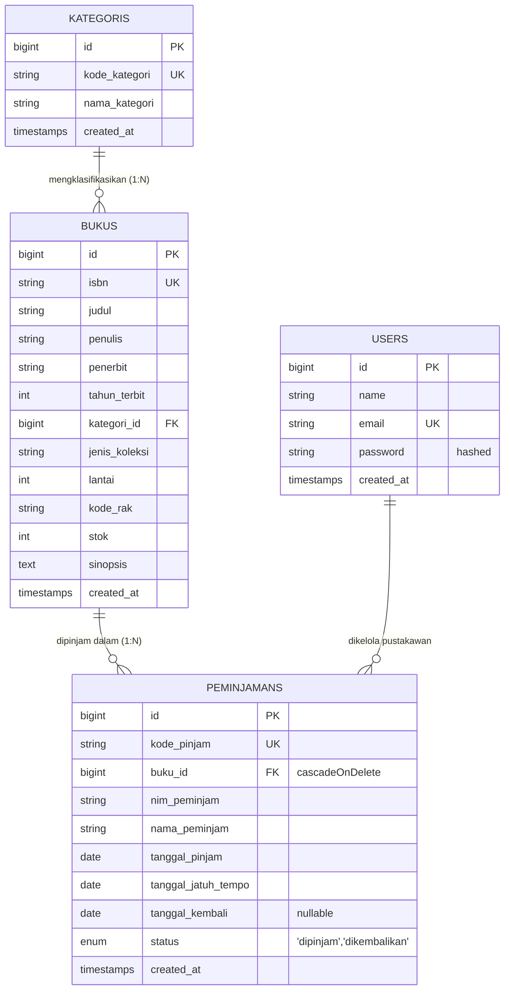

# SIPUS-Del — Sistem Informasi Perpustakaan Institut Teknologi Del

**Praktikum Pemrograman & Pengujian Web (12S3101) — Minggu 06**  
**Identitas Mahasiswa:**
- **Nama:** Jaya Bestina Simbolon
- **NIM:** 12S24023
- **Branch Git:** `week6-db-session`

---

## 🏛️ Deskripsi Proyek

**SIPUS-Del** adalah platform perpustakaan akademik perguruan tinggi berbasis **Laravel 11.x / 12** dan basis data relasional **MySQL 8.0**. Pada pengembangan Tahap 2 (Minggu 6), sistem diperluas dengan:
1. **Konektivitas Basis Data Persisten & Migrasi Sirkulasi:** Skema tabel `peminjamans` dengan foreign key constraint `cascadeOnDelete` ke tabel `bukus`.
2. **Transaksi Basis Data ACID & Concurrency Locking:** Operasi peminjaman dan pengembalian dibungkus dalam `DB::transaction()` dengan Pessimistic Locking (`lockForUpdate()`), pencegahan race condition kuota/stok, validasi stok habis (rollback otomatis), serta penanganan `QueryException`.
3. **Fluent Query Builder & Dynamic Search:** Agregasi statistik perpustakaan menggunakan `DB::table()`, optimasi katalog bebas N+1 melalui eager loading dan `withCount('peminjamans')`, filter dinamis `when()`, dan paginasi `withQueryString()`.
4. **Manajemen Sesi & Autentikasi Pustakawan:** Sistem autentikasi `Auth::attempt()`, regenerasi Session ID saat login (`session()->regenerate()`) guna mitigasi *Session Fixation*, penghancuran sesi aman saat logout, proteksi seluruh rute mutasi oleh middleware `auth`, serta penyimpanan HTTP Cookie aman beratribut `HttpOnly` dan `SameSite=Lax`.

---

## 🗄️ Entity Relationship Diagram (ERD)

Relasi antar entitas dalam basis data `sipus_del`:



### Penjelasan Relasi:
1. **`kategoris` ke `bukus` (One-to-Many):** Satu kategori menaungi banyak koleksi buku. Jika kategori masih memiliki buku terdaftar, penghapusan dicegah melalui konstrain database.
2. **`bukus` ke `peminjamans` (One-to-Many):** Satu buku dapat dipinjam berkali-kali dalam riwayat transaksi sirkulasi. Foreign key `buku_id` dikonfigurasi dengan `cascadeOnDelete()` sehingga integritas referensial terjaga.
3. **Model Eloquent:**
   - `App\Models\Buku` memiliki `hasMany(Peminjaman::class)` dan `belongsTo(Kategori::class)`.
   - `App\Models\Peminjaman` memiliki `belongsTo(Buku::class)`.

---

## 🔑 Kredensial Akun Uji Pustakawan

Sesuai ketentuan modul praktikum Week 6, akun pustakawan resmi yang telah di-*seed* ke dalam sistem:

| Parameter | Nilai Kredensial | Keterangan |
|---|---|---|
| **URL Login** | `http://127.0.0.1:8000/login` | Rute publik formulir login |
| **Email** | `pustakawan@del.ac.id` | Alamat email resmi pustakawan uji |
| **Password** | `password123` | Tersimpan di-hash aman via `bcrypt` |
| **Role/Akses** | Pustakawan Administrator | Berhak mengelola buku, kategori, dan sirkulasi |

---

## ⚙️ Prasyarat Sistem & Konfigurasi Lingkungan

### 1. Prasyarat Perangkat Lunak
- **PHP:** Versi 8.2 atau 8.3 CLI (dengan ekstensi aktif: `pdo`, `pdo_mysql`, `mbstring`, `openssl`).
- **Basis Data:** MySQL 8.0 (InnoDB engine aktif untuk dukungan transaksi ACID dan *Row-Level Locking*).
- **Composer:** Versi 2.x.
- **Node.js & NPM:** Untuk kompilasi aset CSS/JS Vite.

### 2. Konfigurasi File `.env`
Pastikan pengaturan koneksi database MySQL pada berkas `.env` telah disesuaikan:

```env
APP_NAME="SIPUS-Del"
APP_ENV=local
APP_KEY=base64:TNWhqAOZb3qeagPkkSHKI39pBWvgy3x6Zx72J79f1iA=
APP_DEBUG=true
APP_URL=http://localhost:8000

DB_CONNECTION=mysql
DB_HOST=127.0.0.1
DB_PORT=3306
DB_DATABASE=sipus_del
DB_USERNAME=root
DB_PASSWORD=your_mysql_password

SESSION_DRIVER=database
SESSION_LIFETIME=120
SESSION_HTTP_ONLY=true
SESSION_SAME_SITE=lax
```

> **Catatan Keamanan:** Berkas `.env` dan direktori `vendor/` diabaikan oleh Git melalui `.gitignore` dan **dilarang keras** diunggah ke repositori publik.

---

## 🚀 Panduan Menjalankan Aplikasi

Jalankan perintah berikut secara berurutan di terminal:

```bash
# 1. Pindah ke direktori proyek
cd c:\SIPUS-Del

# 2. Pastikan berada pada branch week6-db-session
git checkout week6-db-session

# 3. Instal dependensi PHP (jika belum)
composer install

# 4. Jalankan migrasi basis data (aman, non-destruktif)
php artisan migrate

# 5. Jalankan database seeder (idempoten, mengisi akun pustakawan & sampel peminjaman)
php artisan db:seed

# 6. Kompilasi aset frontend
npm run build

# 7. Jalankan local development server Laravel
php artisan serve
```

Akses aplikasi di browser melalui: `http://127.0.0.1:8000`

---

## 🧪 Panduan Lengkap Pengujian & Verifikasi Fitur Week 6

### 1. Pengujian Peminjaman Buku Normal (ACID Atomik)
1. Buka browser dan akses halaman login: `http://127.0.0.1:8000/login`.
2. Masukkan email `pustakawan@del.ac.id` dan password `password123`.
3. Buka menu **Sirkulasi** (`http://127.0.0.1:8000/peminjaman`) atau halaman detail buku yang stoknya tersedia (`stok > 0`).
4. Isi formulir peminjaman:
   - **Pilih Buku:** Pilih buku dengan stok tersedia (misal: *Laravel Architecture* atau *Pengantar Teknologi Informasi*).
   - **NIM:** `12S24023`
   - **Nama:** `Jaya Bestina Simbolon`
   - **Tanggal Pinjam:** Hari ini
   - **Tanggal Jatuh Tempo:** 7 hari ke depan
5. Klik tombol **"Proses Peminjaman (ACID)"**.
6. **Hasil yang diharapkan:**
   - Muncul flash alert hijau: *"Peminjaman berhasil dicatat secara atomik! Stok buku berkurang 1."*
   - Stok buku di katalog berkurang tepat 1 eksemplar.
   - Transaksi baru muncul pada tabel dengan status **"Sedang Dipinjam"**.

### 2. Pengujian Penolakan & Rollback Saat Stok 0
1. Cari buku dengan stok 0 yang telah disediakan dalam seeder:
   - **Judul:** *Analisis Sentimen Opini Publik pada Twitter Mengenai Program Merdeka Belajar Menggunakan IndoBERT*
   - **ISBN:** `SKR-2024-AI-007`
   - **Stok:** `0 (Habis)`
2. Coba ajukan peminjaman buku tersebut melalui menu **Sirkulasi** (`/peminjaman`).
3. **Hasil yang diharapkan:**
   - Transaksi dibatalkan oleh blok `DB::transaction()`.
   - Muncul pesan peringatan merah: *"Transaksi dibatalkan (Rollback): Stok buku ... habis (0 eksemplar)."*
   - Tidak ada baris transaksi baru yang tersimpan ke tabel `peminjamans`.
   - Stok buku tetap 0 dan tidak pernah bernilai negatif.

### 3. Pengujian Pencegahan Peminjaman Ganda oleh NIM yang Sama
1. Pinjam sebuah buku dengan NIM `12S24023`.
2. Selagi transaksi tersebut masih berstatus **"Sedang Dipinjam"**, coba ajukan peminjaman buku yang sama untuk NIM `12S24023` sekali lagi.
3. **Hasil yang diharapkan:**
   - Sistem menolak transaksi dan melempar pesan error: *"NIM 12S24023 masih memiliki transaksi peminjaman aktif untuk buku ini. Selesaikan pengembalian terlebih dahulu."*
   - Stok buku tidak berkurang untuk percobaan kedua.

### 4. Pengujian Pengembalian Buku (ACID Atomik)
1. Pada tabel riwayat sirkulasi di halaman `/peminjaman`, cari transaksi yang berstatus **"Sedang Dipinjam"**.
2. Klik tombol kuning **"Kembalikan Buku"**.
3. Konfirmasi dialog peringatan browser.
4. **Hasil yang diharapkan:**
   - Status transaksi berubah menjadi hijau **"Dikembalikan"**.
   - Kolom `tanggal_kembali` terisi dengan tanggal hari ini.
   - Stok buku yang bersangkutan bertambah tepat 1 eksemplar.
5. Tombol kembalikan menghilang dan digantikan label *"Transaksi Selesai"*, sehingga mencegah pengembalian berulang dan menjaga stok agar tidak bertambah dua kali.

### 5. Pengujian Proteksi Akses Tanpa Login (Middleware `auth`)
1. Buka browser pada mode **Incognito / Private Window** (atau lakukan Logout).
2. Coba akses langsung URL mutasi berikut di address bar:
   - `http://127.0.0.1:8000/peminjaman`
   - `http://127.0.0.1:8000/buku-baru/create`
   - `http://127.0.0.1:8000/kategori-baru/create`
3. **Hasil yang diharapkan:**
   - Pengguna tamu langsung dicegat oleh middleware `auth` dan dialihkan ke `http://127.0.0.1:8000/login`.
   - Data katalog publik (`/katalog`, `/`, `/buku/{id}`) tetap dapat dibaca tanpa login.

### 6. Pengujian Audit Cookie `HttpOnly` & `SameSite` di Browser DevTools
1. Lakukan login di `http://127.0.0.1:8000/login` dengan akun pustakawan.
2. Buka **Developer Tools** (tekan `F12` atau `Ctrl + Shift + I` pada Chrome/Edge).
3. Pilih tab **Application** (atau **Storage** pada Firefox).
4. Pada panel sebelah kiri, buka menu **Cookies** -> `http://127.0.0.1:8000` (atau `http://localhost:8000`).
5. Periksa baris cookie:
   - **`del_last_user_email`**: Berisi nilai email pustakawan terenkripsi, flag **HttpOnly** bertanda centang/aktif, dan atribut **SameSite** bernilai `Lax`.
   - **`sipus-del-session`**: Cookie sesi server ber-flag **HttpOnly** aktif dan **SameSite** `Lax`.
6. Coba jalankan perintah `document.cookie` pada tab **Console**.
7. **Hasil:** Cookie yang bertanda `HttpOnly` tidak dapat diakses atau dicuri oleh skrip JavaScript sisi klien (mitigasi serangan XSS).

---

## 📸 Daftar Screenshot Bukti Pengujian Praktikum

Untuk pelaporan praktikum Week 6 ke dosen pengampu/asisten lab, kumpulkan tangkapan layar (*screenshot*) berikut:

1. **Screenshot 1 — Verifikasi Status Database & Migrasi:**
   - Tampilan terminal menjalankan: `php artisan db:show` dan `php artisan migrate:status`.
   - Memperlihatkan tabel `peminjamans` berstatus *Ran* dan terkoneksi ke MySQL `sipus_del`.
2. **Screenshot 2 — Halaman Login & Prefill Cookie:**
   - Tampilan form login pustakawan di `/login` dengan notifikasi email termuat otomatis dari cookie `del_last_user_email`.
3. **Screenshot 3 — Audit DevTools Cookie HttpOnly:**
   - Tampilan tab *Application -> Cookies* pada browser memperlihatkan cookie `del_last_user_email` dan cookie sesi dengan centang *HttpOnly* serta *SameSite=Lax*.
4. **Screenshot 4 — Transaksi Peminjaman Berhasil (Stok Berkurang):**
   - Halaman `/peminjaman` memperlihatkan flash message sukses peminjaman atomik dan stok buku berkurang 1.
5. **Screenshot 5 — Bukti Penolakan & Rollback Saat Stok 0:**
   - Halaman `/peminjaman` memperlihatkan penolakan peminjaman buku stok 0 (*Analisis Sentimen...*) dengan pesan error rollback, tanpa penambahan baris transaksi.
6. **Screenshot 6 — Transaksi Pengembalian Berhasil (Stok Bertambah):**
   - Halaman `/peminjaman` memperlihatkan transaksi yang diubah statusnya menjadi *Dikembalikan* dan stok buku bertambah kembali 1.
7. **Screenshot 7 — Katalog dengan `withCount('peminjamans')` & Kartu Statistik:**
   - Halaman `/katalog` memperlihatkan 4 kartu statistik *Fluent Query Builder* (Total Judul, Stok Tersedia, Sedang Dipinjam, Total Dikembalikan) serta badge `X kali dipinjam` pada setiap kartu buku.
8. **Screenshot 8 — Proteksi Middleware Auth:**
   - Tampilan browser saat mengakses `/peminjaman` tanpa login yang langsung dialihkan secara otomatis ke `/login`.

---

## 🛡️ Otomasi Pengujian Unit & Fitur (PHPUnit)

Seluruh logika bisnis, transaksi ACID, concurrency locking, proteksi middleware, serta integritas sesi telah diuji secara otomatis:

```bash
php artisan test
```

**Hasil Pengujian:**
- 12 Tests Passed (100%)
- 47 Assertions Passed
- Waktu eksekusi: ~1.4 detik
